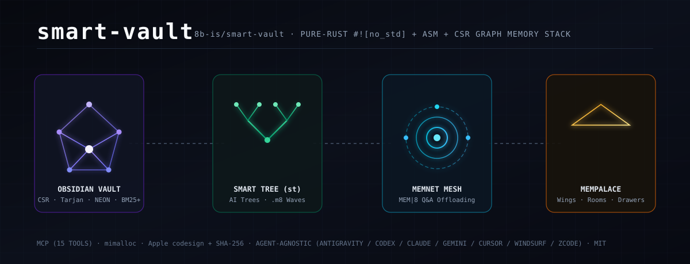
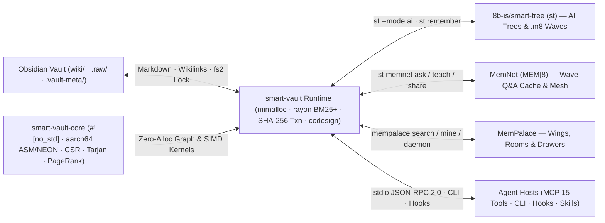

<p align="center">
  
</p>

<p align="center">
  <a href="Cargo.toml"></a>
  <a href="LICENSE"></a>
  <a href="#agent-agnostic-mcp-server-15-tools"></a>
  <a href="https://github.com/8b-is/smart-tree"></a>
  <a href="https://github.com/8b-is/smart-tree"></a>
  <a href="docs/m1-antigravity-mempalace-guide.md"></a>
  <a href="ATTRIBUTION.md"></a>
</p>

<p align="center">
  <b>Sovereign, agent-agnostic second brain for <a href="https://obsidian.md">Obsidian</a> — zero-alloc <code>#![no_std]</code> graph/ASM core wired into <a href="https://github.com/8b-is/smart-tree">8b-is/smart-tree</a> (<code>st</code>), <code>MemNet</code> (<code>MEM|8</code>), and <code>MemPalace</code>.</b><br />
  Drop in raw sources. Maintain a cited, CSR-analyzed, NEON/ASM-accelerated, SHA-256 crash-safe Markdown knowledge graph across every AI host.<br />
  <sub>Made with &lt;3 from <b>8b.is-crew</b> · Evolved from <a href="https://github.com/AgriciDaniel/claude-obsidian">AgriciDaniel/claude-obsidian</a> (MIT)</sub>
</p>

---

## Steno-Ontological Stack

`smart-vault` (`sv`) unifies four sovereign memory layers behind a zero-dependency `#![no_std]` kernel ([crates/smart-vault-core](crates/smart-vault-core/src/lib.rs)), a `mimalloc`-accelerated signed Rust binary, and a 15-tool stdio JSON-RPC 2.0 MCP server:



| Layer / Entity | Canonical Representation | Engine / Binary | Invariant | Observed Capabilities & Architecture |
|---|---|---|---|---|
| **L0 · `#![no_std]` Kernel** | `CsrGraph`, bitsets, stack `TopK`, slice scanners | [`smart-vault-core`](crates/smart-vault-core/Cargo.toml) (`asm.rs`, `graph.rs`, `scan.rs`, `bm25_math.rs`) | Zero heap allocation, zero dependencies (`no_std`), pure IEEE-754 math | `aarch64` NEON 16B `simd_ascii_lowercase_in_place` & `simd_contains_byte`, `rbit`/`clz` `ctz_u64`, barrier `ct_eq_bytes`, iterative Tarjan SCC & PageRank |
| **L1 · Obsidian Vault** | `wiki/**/*.md`, `.raw/` payloads, `.smart-vault.json`, `.vault-meta/` | `smart-vault` (`src/vault.rs`, `src/lint.rs`, `src/bm25.rs`, `src/transaction.rs`) | `.raw/` is create-only; mutations require `fs2` lock, SHA-256 plan approval & pre-image journal | Parallel CSR graph lint + cyclic SCC/hub detection, `rayon` BM25+ index/query, `mimalloc` allocator, `Wl,-dead_strip` + fat LTO |
| **L2 · Smart Tree** | AI-compressed trees (<code>--mode ai&#124;classic&#124;quantum&#124;json</code>) & `.vault-meta/vault.m8` waves | `st` (`8b-is/smart-tree`) + Rust `WalkDir`/`rayon` fallback (`src/smart_tree.rs`) | Read-only structural probes (`--no-update-check`); automatic Rust fallback when `st` is absent | Native compiled `st` binary with built-in parallel Rust fallback |
| **L3 · MemNet Mesh** | <code>MEM&#124;8</code> wave Q&A packets (`ask` / `teach`), live `routes`, shared folder quotas | `st memnet` bridged via `src/memnet.rs` | Bounded subprocess timeouts (`5 s` mesh ops, `1.5 s` hybrid `--mesh` check); non-blocking fallback to BM25+ | Checked ahead of/alongside local BM25+ with `1.5 s` hybrid timeout |
| **L4 · MemPalace** | Verbatim Wings / Rooms / Drawers (`~/.config/mempalace/palace`, ChromaDB + HNSW + SQLite) | `mempalace` / `mempalace-mcp` / `mempalace daemon` (`src/mempalace.rs`) | Fast read-only `repair-status` default (`--full` opt-in); bounded timeouts (`10 s` fast / `45 s` heavy / `5 s` hook) | Warm `mempalace daemon` avoids cold ChromaDB/HNSW reload across `1.56M+` drawers |
| **Control & Signing** | Stdio JSON-RPC 2.0 (`15` tools), lifecycle hooks, `skills/*/SKILL.md`, `.sha256` sidecars | `smart-vault mcp`, `hook`, `sign`, `verify-binary`, `setup-host`, `setup-global` | Diagnostics on `stderr` only; dry-run by default (`--apply` required); `0600` secret-bearing configs + macOS `codesign` | Signed global `~/.local/bin/smart-vault` + `sv` symlink; zero Python/Bash runtime required |

---

## Quick Start & M1 64 GB Global Setup

### Build, Sign & Install

```bash
cargo build --release
cargo install --path .
```

### Automated M1 64 GB Global Setup (Antigravity IDE + CLI + MemPalace)

See [docs/m1-antigravity-mempalace-guide.md](docs/m1-antigravity-mempalace-guide.md) for the full architecture and rollback flow:

```bash
# Preview global binary, codesign, MCP server merges, lifecycle hooks, and skill links (no writes)
smart-vault setup-global

# Apply idempotently (installs signed ~/.local/bin/smart-vault + sv symlink, creates .json.bak backups)
smart-vault setup-global --apply

# Verify OS signature and constant-time SHA-256 digest anytime
smart-vault verify-binary ~/.local/bin/smart-vault

# Optional: keep MemPalace ChromaDB + HNSW resident in M1 64 GB unified memory
smart-vault palace daemon start
```

### Core Vault, Smart Tree, MemNet & MemPalace Commands

```bash
# Inspect vault readiness, locks/journals, Smart Tree (`st`), MemNet mesh, and MemPalace
smart-vault doctor --vault examples/sample-vault

# Preview creating a new vault (or adopting an existing Obsidian vault), then apply
smart-vault init --vault /path/to/my-vault
smart-vault init --vault /path/to/my-vault --apply
smart-vault adopt --vault /path/to/existing-vault --apply

# Parallel scan, CSR graph lint (with Tarjan SCC & PageRank hubs), and BM25+ inverted index
smart-vault scan --vault /path/to/my-vault
smart-vault lint --vault /path/to/my-vault --format markdown
smart-vault index --vault /path/to/my-vault

# Unified hybrid query across MemNet MEM|8 wave cache + MemPalace drawers + local BM25+
sv query --vault /path/to/my-vault "source-grounded notes" --mesh --palace --top 8

# Smart Tree AI-compressed view & salient MEM|8 wave sync
smart-vault tree --vault /path/to/my-vault --mode ai --depth 3
smart-vault remember --vault /path/to/my-vault --level expert

# MemNet mesh telemetry, wave Q&A, and folder sharing
smart-vault mesh status
smart-vault mesh routes
smart-vault mesh teach "how does smart-vault handle links?" "Parallel CSR graph lint checks wikilinks and markdown links."
smart-vault mesh ask "how does smart-vault handle links?"
smart-vault mesh share --vault /path/to/my-vault --quota-mb 4096

# MemPalace status, L0+L1 wake-up, and wiki mining
smart-vault palace status
smart-vault palace wake-up
smart-vault palace mine --vault /path/to/my-vault --wing my_vault

# SHA-256 approval-pinned atomic transactions & crash recovery
smart-vault transaction inspect bundle.json
smart-vault transaction apply bundle.json --approved-plan-sha256 <sha256>
smart-vault transaction recover

# Binary signing & verification (macOS codesign + constant-time SHA-256)
smart-vault sign target/release/smart-vault --write-sha256
smart-vault verify-binary target/release/smart-vault
```

### Agent-Agnostic MCP Server (15 Tools)

Run `smart-vault mcp` directly or register it in any MCP-compatible host (Antigravity, Codex, Claude Code, Gemini, Cursor, Windsurf, OpenCode, ZCode):

```json
{
  "mcpServers": {
    "smart-vault": {
      "command": "smart-vault",
      "args": ["mcp"]
    }
  }
}
```

Exposed tools (`15`):
- **Vault (`7`)**: `vault_doctor`, `vault_scan`, `vault_tree`, `vault_lint`, `vault_index`, `vault_query`, `vault_remember`
- **MemNet (`4`)**: `mesh_status`, `mesh_ask`, `mesh_teach`, `mesh_share`
- **MemPalace (`4`)**: `palace_status`, `palace_wake_up`, `palace_search`, `palace_mine`

Link `skills/` into any AI host (dry-run by default):

```bash
smart-vault setup-host --host all
smart-vault setup-host --host gemini --apply
smart-vault setup-host --host cursor --workspace /path/to/project --apply
```

---

## Contracts, Security & Verification

- Agent contract & vault boundaries: [AGENTS.md](AGENTS.md)
- Vault schema & frontmatter contract: [WIKI.md](WIKI.md)
- Privacy & security invariants: [PRIVACY.md](PRIVACY.md) · [SECURITY.md](SECURITY.md)
- Contributing guidelines: [CONTRIBUTING.md](CONTRIBUTING.md)

```bash
make fmt          # cargo fmt --all --check
make check-nostd  # cargo check -p smart-vault-core --no-default-features
make lint         # cargo clippy --workspace --all-targets -- -D warnings -D dead_code -D unused_imports
make test         # cargo test --workspace + contracts + package validate
make release      # cargo build --release (fat LTO, target-cpu=native, stripped)
make sign         # release + macOS codesign + .sha256 sidecar
make bench        # Criterion microbenchmarks (benches/vault_bench.rs)
```

---

## Acknowledgments & Built Upon

- **AgriciDaniel & contributors ([`AgriciDaniel/claude-obsidian`](https://github.com/AgriciDaniel/claude-obsidian))** — original MIT-licensed Obsidian LLM Wiki skill suite, vault schema, and transactional safety design (full contributor PR and issue credits in [ATTRIBUTION.md](ATTRIBUTION.md)).
- **Andrej Karpathy ([`karpathy`](https://github.com/karpathy))** — the LLM Wiki pattern for compounding, source-grounded personal knowledge graphs.
- **[`8b-is/smart-tree`](https://github.com/8b-is/smart-tree) (`st`)** — AI-compressed directory intelligence and `MEM|8` wave persistence by `8bit-wraith`, `Claude`, `Omni`, and `8b.is-crew`.
- **[`MemNet`](https://github.com/8b-is/smart-tree)** — sovereign multi-medium mesh and `MEM|8` wave Q&A cache offloading (`st memnet`).
- **`MemPalace`** — verbatim spatial Wings/Rooms/Drawers memory palace backed by ChromaDB, SQLite, and HNSW (integrated via `smart-vault palace` and [docs/m1-antigravity-mempalace-guide.md](docs/m1-antigravity-mempalace-guide.md)).
- **[Obsidian](https://obsidian.md) & [`kepano/obsidian-skills`](https://github.com/kepano/obsidian-skills)** — Obsidian Flavored Markdown, JSON Canvas, and Obsidian Bases design references (recorded in [config/upstream-references.json](config/upstream-references.json)).
- **Pure-Rust Ecosystem** — [`mimalloc`](https://crates.io/crates/mimalloc), [`clap`](https://crates.io/crates/clap), [`rayon`](https://crates.io/crates/rayon), [`memchr`](https://crates.io/crates/memchr), [`serde`](https://crates.io/crates/serde), [`sha2`](https://crates.io/crates/sha2), [`fs2`](https://crates.io/crates/fs2), [`rustc-hash`](https://crates.io/crates/rustc-hash), [`unicode-normalization`](https://crates.io/crates/unicode-normalization), [`walkdir`](https://crates.io/crates/walkdir), and [`criterion`](https://crates.io/crates/criterion) (see [Cargo.toml](Cargo.toml), [crates/smart-vault-core/Cargo.toml](crates/smart-vault-core/Cargo.toml), and [ATTRIBUTION.md](ATTRIBUTION.md)).

---

## License

Licensed under the **MIT License** — see [LICENSE](LICENSE).

Made with `<3` from **8b.is-crew**.
